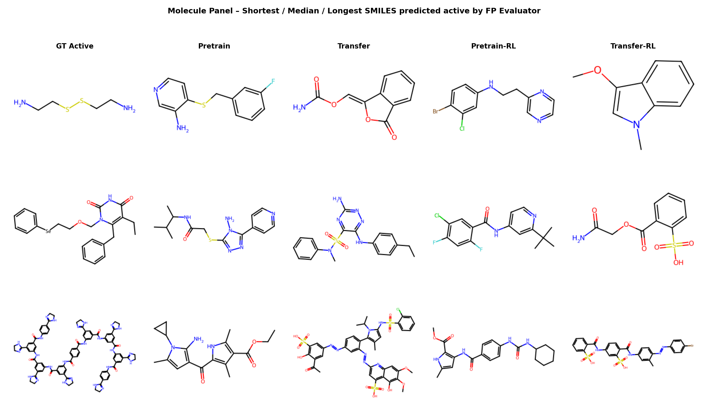
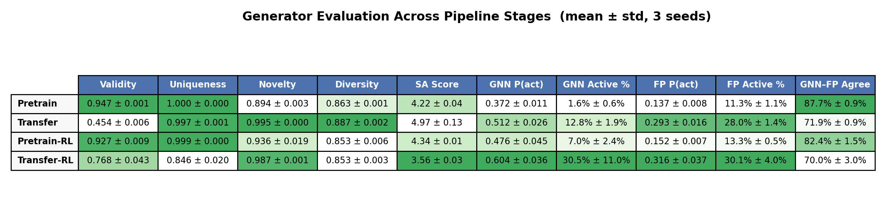

# Molecule Generation with Reinforcement Learning

A character-level SMILES language model that generates new drug-like molecules, steered with reinforcement learning towards molecules predicted to be active against HIV. The project compares four training pipelines, each run with three seeds, and checks the results with two independent activity predictors.

  

## Pipeline

1. **Pretrain** an LSTM on SMILES strings from the MOSES dataset (1.5 million drug-like molecules) so it learns to write valid molecules.
2. **Transfer learning.** Fine-tune on about 1,000 known HIV actives from MoleculeNet HIV.
3. **Reinforcement learning (REINFORCE).** Fine-tune with a composite reward of 60% predicted HIV activity, 20% chemical validity and 20% synthetic accessibility.
4. **Activity prediction.** A graph neural network (GINE, edge-aware) trained on 41k molecules with scaffold splits and a 28:1 class imbalance provides the reward (ROC-AUC 0.76). A separate Morgan-fingerprint logistic regression model, never used in training, acts as an independent check against the generator gaming its reward.

## Results

Mean over three seeds. "Active %" is the share of generated molecules predicted active.

| Pipeline | Validity | Novelty | Synthetic accessibility (lower is easier) | Active % (GNN, reward model) | Active % (independent FP model) |
|---|---|---|---|---|---|
| Pretrain | 0.947 | 0.894 | 4.22 | 1.6% | 11.3% |
| Transfer | 0.454 | 0.995 | 4.97 | 12.8% | 28.0% |
| Pretrain + RL | 0.927 | 0.936 | 4.34 | 7.0% | 13.3% |
| **Transfer + RL** | 0.768 | 0.987 | **3.56** | **30.5%** | **30.1%** |

  

**Takeaways.**
- Transfer learning alone shifts the generator towards active-looking chemistry but breaks it, with fewer than half its outputs valid.
- Reinforcement learning on top of transfer learning restores validity and makes molecules easier to synthesise. It also roughly doubles the predicted active share compared with transfer learning alone.
- The independent fingerprint model agrees (30.1% vs 30.5%), so the gain is not just the generator exploiting its own reward model.

## Get started

Installation, data preparation, training and plotting are described in [SETUP.md](SETUP.md).

Built with Python, PyTorch, PyTorch Geometric and RDKit.
